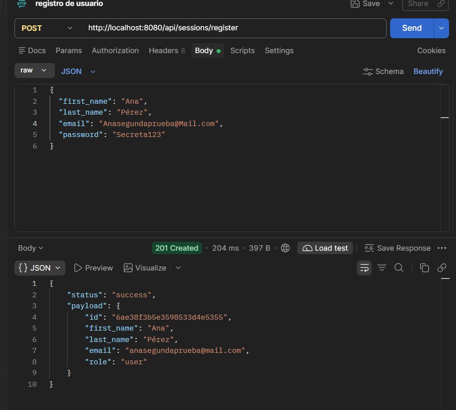
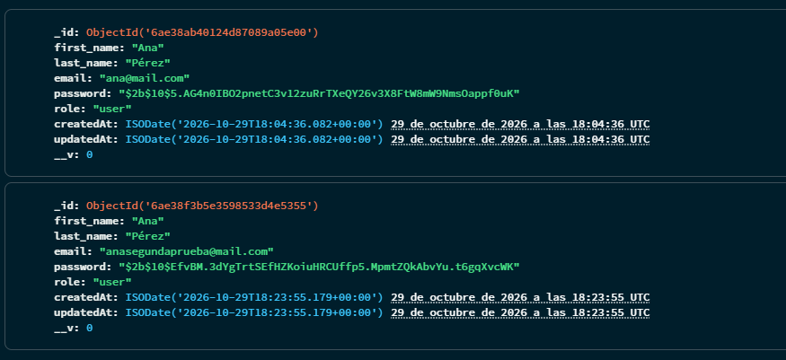
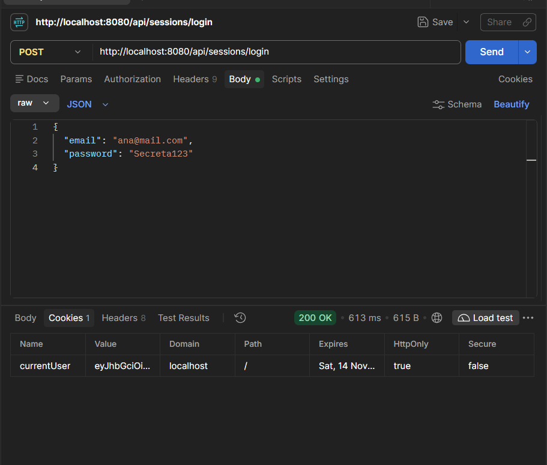
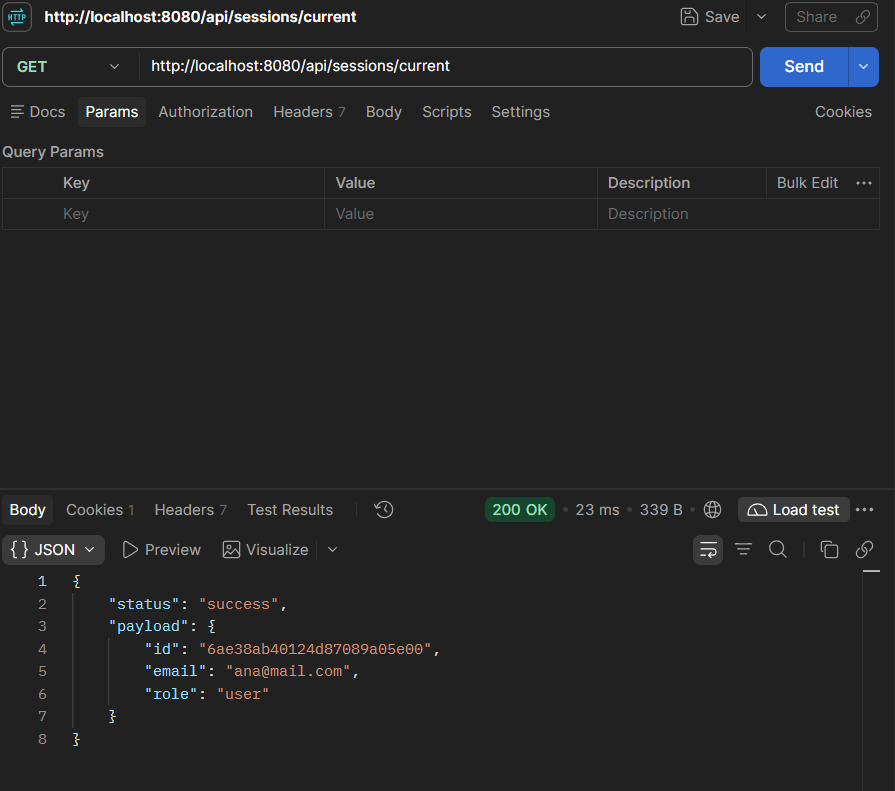
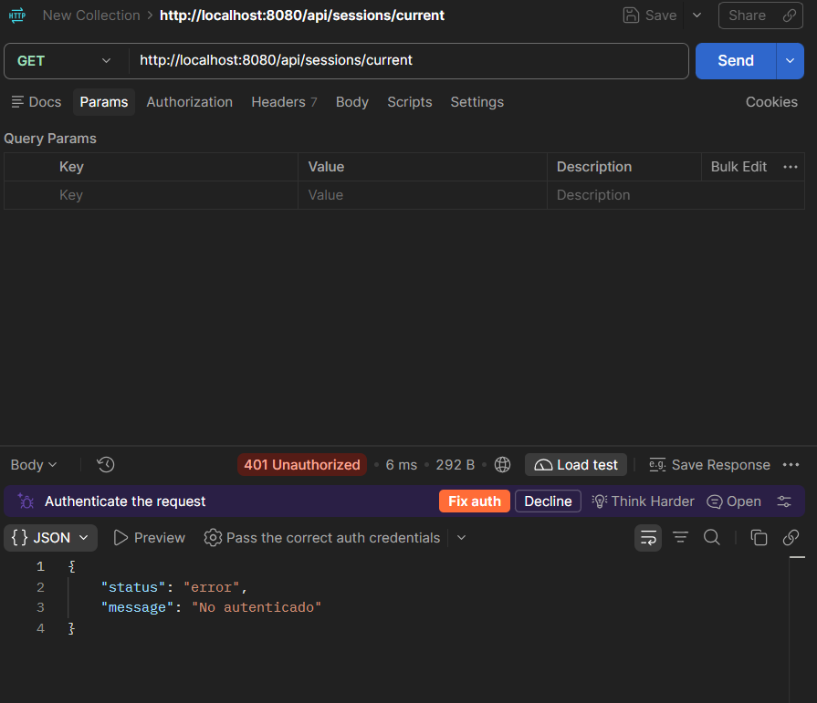

# 🎭 Plataforma de Eventos e Inscripciones (Castings Teatrales y Audiovisuales)

API REST modular y escalable para la gestión de eventos, audiciones y castings en Córdoba Capital. Permite a los usuarios consultar convocatorias y eventos artísticos, registrarse y autenticarse mediante **Passport.js** con JWT almacenado en cookies `HttpOnly`, y consultar su sesión activa.

> Proyecto desarrollado para la cursada de **Programación Backend II - Coderhouse**.

---

## 🚀 Tecnologías Utilizadas

* **Node.js** (v20+ con soporte nativo para módulos ESM)
* **Express.js** (Framework web minimalista para routing y middlewares)
* **MongoDB & Mongoose** (Base de datos NoSQL y ODM para modelado de datos)
* **Passport.js** (`passport`, `passport-local`, `passport-jwt`) (Estrategias centralizadas de autenticación)
* **Bcrypt** (Algoritmo de hashing seguro para contraseñas)
* **JsonWebToken (JWT)** (Generación y verificación de tokens de autenticación)
* **Cookie-Parser** (Lectura y manejo de cookies `HttpOnly` en Express)
* **Dotenv** (Gestión segura de variables de entorno)
* **Node Test Runner** (`node:test` y `node:assert` nativos)

---

## ⚙️ Configuración de Variables de Entorno

1. Copiá el archivo `.env.example` en la raíz del proyecto y renombralo a `.env`:
   ```bash
   cp .env.example .env
   ```
2. Configurá las variables según tu entorno:
   * `PORT`: Puerto de escucha del servidor (por defecto `8080`).
   * `NODE_ENV`: Entorno de ejecución (`development` / `production`).
   * `MONGO_URL`: URI de conexión a la base de datos MongoDB.
   * `JWT_SECRET`: Clave secreta para la firma de tokens JWT.
   * `JWT_EXPIRES_IN`: Tiempo de expiración de los tokens JWT (por ejemplo `1h`).

---

## 📦 Instalación y Ejecución

1. **Clonar el repositorio e ingresar a la carpeta:**
   ```bash
   git clone <URL_DEL_REPOSITORIO>
   cd proyecto-backend-2
   ```

2. **Instalar dependencias:**
   ```bash
   npm install
   ```

3. **Ejecución en modo desarrollo (recarga automática con Node):**
   ```bash
   npm run dev
   ```

4. **Ejecución en producción:**
   ```bash
   npm start
   ```

5. **Ejecutar tests automatizados:**
   ```bash
   npm test
   ```

---

## 🏛️ Arquitectura por Capas

El proyecto está diseñado siguiendo una arquitectura en capas desacoplada para garantizar escalabilidad, legibilidad y facilidad de testing:

```text
src/
├── app.js               # Configuración de Express, cookie-parser, Passport y montaje de rutas (sin listen)
├── server.js            # Punto de entrada operacional: conexión a MongoDB y listen del servidor
├── config/              # Variables de entorno, conexión a MongoDB y estrategias de Passport (passport.config.js)
├── routes/              # Definición de endpoints HTTP y delegación en estrategias de Passport
├── controllers/         # Recepción de peticiones (req), generación de JWT, cookies y envío de respuestas
├── services/            # Capa reservada para lógica de negocio de próximos módulos (eventos, tickets)
├── repositories/        # Abstracción de acceso a datos independiente del motor de base de datos
├── dao/                 # Data Access Object: operaciones directas de persistencia con Mongoose
├── models/              # Esquemas y modelos de datos (User, Event)
├── middlewares/         # Middleware puente passportCall (Passport) y futura autorización por rol
└── utils/               # Funciones utilitarias transversales (hash.js con bcrypt, jwt.js con jsonwebtoken)
```

---

## 🔐 Estrategias de Autenticación (Passport.js)

Toda la lógica de autenticación y validación de credenciales está centralizada en `src/config/passport.config.js` e inicializada desde `src/app.js` mediante `initializePassport()` y `passport.initialize()`. Las rutas delegan en Passport con sesiones deshabilitadas (`session: false`) usando el wrapper `passportCall(strategy)` de `src/middlewares/auth.middleware.js`.

| Estrategia | Tipo | Qué hace |
| :--- | :--- | :--- |
| `register` | `passport-local` | Valida campos obligatorios, formato de email y longitud mínima de contraseña; normaliza email; verifica unicidad (`409`); hashea con `bcrypt` y crea el usuario con rol `user` por defecto (sin devolver `password`). |
| `login` | `passport-local` | Normaliza el email, busca el usuario y compara la contraseña con `comparePassword`. Si falla responde `401` `"Credenciales inválidas"`. Si coincide, entrega `{ id, email, role }` en `req.user` para que el **controller** firme el JWT y guarde la cookie `currentUser` (`httpOnly: true`). |
| `current` | `passport-jwt` | Extrae el token desde la cookie `currentUser`, verifica firma y expiración con `JWT_SECRET` y carga `{ id, email, role }` en `req.user` (o responde `401` `"No autenticado"` si no hay token válido). |

> **Nota sobre Logout:** `POST /api/sessions/logout` limpia directamente la cookie `currentUser` desde `sessions.controller.js`, sin requerir pasar por Passport.

### Preparación para futuros providers externos
La estructura de `src/config/passport.config.js` queda preparada para incorporar nuevas estrategias de autenticación con **providers externos (Google, GitHub, etc.)** registrándolas dentro de `initializePassport()`, **sin necesidad de modificar `src/app.js`** ni reescribir el manejo de JWT y cookies.

---

## 📋 Resumen de Rutas

| Método | Ruta | Descripción | Requiere Auth |
| :--- | :--- | :--- | :--- |
| `GET` | `/api/health` | Verifica el estado operativo del servidor | No |
| `GET` | `/api/events` | Lista eventos y castings disponibles | No |
| `POST` | `/api/sessions/register` | Registra un nuevo usuario con contraseña hasheada | No |
| `POST` | `/api/sessions/login` | Inicia sesión y guarda JWT en cookie `currentUser` (`HttpOnly`) | No |
| `GET` | `/api/sessions/current` | Devuelve los datos mínimos del usuario autenticado (`{ id, email, role }`) | Sí (Cookie `currentUser`) |
| `POST` | `/api/sessions/logout` | Cierra la sesión eliminando la cookie `currentUser` | No |

---

## 🔌 Documentación de Endpoints

### 1. Sistema & Health Check

#### `GET /api/health`
Verifica que el servidor esté activo.

* **Respuesta exitosa (`200 OK`):**
```json
{
  "status": "ok",
  "message": "Servidor activo"
}
```

---

### 2. Eventos (Castings y Convocatorias)

#### `GET /api/events`
Lista de eventos y castings disponibles.

* **Respuesta exitosa (`200 OK`):**
```json
{
  "status": "success",
  "payload": []
}
```

---

### 3. Sesiones y Autenticación

#### `POST /api/sessions/register`
Delega en la estrategia `'register'` de **Passport.js** (`passport-local`). Valida campos obligatorios, formato de email, longitud mínima de contraseña (6 caracteres), normaliza el email (`trim` y `lowercase`), evita duplicados, hashea la contraseña mediante `bcrypt` y registra al usuario en MongoDB asignando el rol `user` por defecto.

* **Request (JSON):**
```json
{
  "first_name": "Ana",
  "last_name": "Pérez",
  "email": "Ana@Mail.com",
  "password": "Secreta123"
}
```

* **Respuesta exitosa (`201 Created`):**
*(El email se guarda normalizado y nunca se devuelve la contraseña)*
```json
{
  "status": "success",
  "payload": {
    "id": "6721...",
    "first_name": "Ana",
    "last_name": "Pérez",
    "email": "ana@mail.com",
    "role": "user"
  }
}
```

* **Errores posibles:**
  * `400 Bad Request` (Faltan campos obligatorios o formato inválido):
    ```json
    {
      "status": "error",
      "message": "Faltan campos obligatorios"
    }
    ```
  * `409 Conflict` (El email ya existe):
    ```json
    {
      "status": "error",
      "message": "El email ya está registrado"
    }
    ```

---

#### `POST /api/sessions/login`
Delega la validación de `email` y `password` en la estrategia `'login'` de **Passport.js** (`passport-local` + `comparePassword`). Tras la autenticación exitosa, **`sessions.controller.js`** (no la estrategia) firma un JWT con `{ id, email, role }` y lo guarda en la cookie **`currentUser`** (`httpOnly: true`, `sameSite: 'lax'`, `maxAge: 3600000`, `secure: true` solo en producción).

* **Request (JSON):**
```json
{
  "email": "ana@mail.com",
  "password": "Secreta123"
}
```

* **Respuesta exitosa (`200 OK`):**
*(Además setea la cookie `currentUser` `HttpOnly` en la cabecera `Set-Cookie`)*
```json
{
  "status": "success",
  "message": "Login correcto"
}
```

* **Errores posibles:**
  * `400 Bad Request` (Falta email o password):
    ```json
    {
      "status": "error",
      "message": "Faltan campos obligatorios"
    }
    ```
  * `401 Unauthorized` (Email inexistente o contraseña incorrecta — mensaje genérico):
    ```json
    {
      "status": "error",
      "message": "Credenciales inválidas"
    }
    ```

---

#### `GET /api/sessions/current`
Ruta protegida mediante la estrategia `'current'` de **Passport.js** (`passport-jwt` vía `passportCall('current')`). Extrae el JWT de la cookie `currentUser`, verifica firma y expiración, deja los datos en `req.user` y devuelve la sesión actual sin exponer la contraseña.

* **Request:** Enviar cookie `currentUser` (Postman y navegadores la adjuntan automáticamente después del login).

* **Respuesta exitosa (`200 OK`):**
```json
{
  "status": "success",
  "payload": {
    "id": "6ae38ab40124d87089a05e00",
    "email": "ana@mail.com",
    "role": "user"
  }
}
```

* **Error posible (`401 Unauthorized` — sin cookie, token inválido o expirado):**
```json
{
  "status": "error",
  "message": "No autenticado"
}
```

---

#### `POST /api/sessions/logout`
Cierra la sesión actual eliminando la cookie `currentUser`.

* **Respuesta exitosa (`200 OK`):**
```json
{
  "status": "success",
  "message": "Sesión cerrada"
}
```

---

## 📸 Evidencia de Pruebas

### 1. Registro exitoso en Postman (Status 201 Created)


### 2. Contraseña hasheada en MongoDB Atlas


### 3. Login exitoso y cookie HttpOnly en Postman (Status 200 OK)


### 4. Ruta protegida /current con cookie válida (Status 200 OK)


### 5. Ruta protegida /current sin cookie luego de logout (Status 401 Unauthorized)
