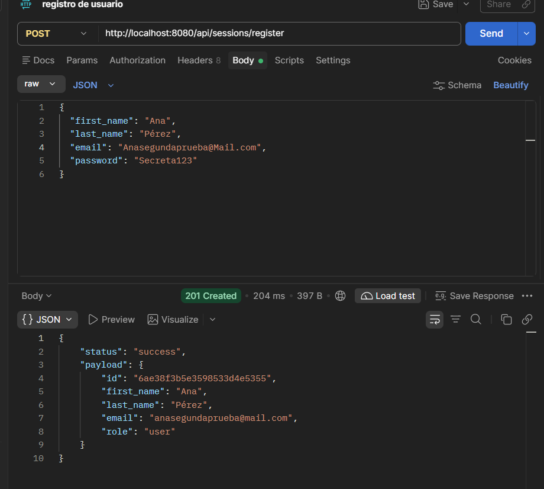
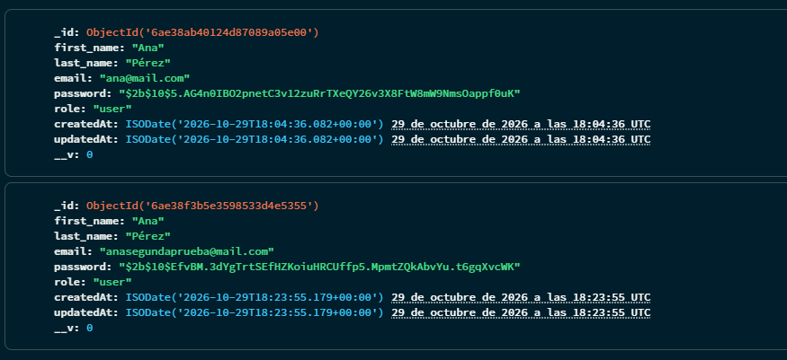

# 🎭 Plataforma de Eventos e Inscripciones (Castings Teatrales y Audiovisuales)

API REST modular y escalable para la gestión de eventos, audiciones y castings en Córdoba Capital. Permite a los usuarios consultar convocatorias y eventos artísticos, así como organizar y participar en audiciones mediante un sistema de reservas y tickets.

> Proyecto desarrollado para la cursada de **Programación Backend II - Coderhouse**.

---

## 🚀 Tecnologías Utilizadas

* **Node.js** (v20+ con soporte nativo para módulos ESM)
* **Express.js** (Framework web minimalista para routing y middlewares)
* **MongoDB & Mongoose** (Base de datos NoSQL y ODM para modelado de datos)
* **Bcrypt** (Algoritmo de hashing seguro para contraseñas)
* **Dotenv** (Gestión segura de variables de entorno)
* **Node Test Runner** (`node:test` y `node:assert` nativos)

---

## ⚙️ Configuración de Variables de Entorno

1. Copiá el archivo `.env.example` en la raíz del proyecto y renombralo a `.env`:
   ```bash
   cp .env.example .env
   ```
2. Configurá las variables según tu entorno:
   * `PORT`: Puerto de escucha del servidor (por defecto `8080`).
   * `NODE_ENV`: Entorno de ejecución (`development` / `production`).
   * `MONGO_URL`: URI de conexión a la base de datos MongoDB.
   * `JWT_SECRET`: Clave secreta para la firma de tokens de autenticación.

---

## 📦 Instalación y Ejecución

1. **Clonar el repositorio e ingresar a la carpeta:**
   ```bash
   git clone <URL_DEL_REPOSITORIO>
   cd proyecto-backend-2
   ```

2. **Instalar dependencias:**
   ```bash
   npm install
   ```

3. **Ejecución en modo desarrollo (recarga automática con Node):**
   ```bash
   npm run dev
   ```

4. **Ejecución en producción:**
   ```bash
   npm start
   ```

5. **Ejecutar tests unitarios:**
   ```bash
   npm test
   ```

---

## 🏛️ Arquitectura por Capas

El proyecto está diseñado siguiendo una arquitectura en capas desacoplada para garantizar escalabilidad, legibilidad y facilidad de testing:

```text
src/
├── app.js               # Configuración de Express, middlewares globales y montaje de rutas (sin listen)
├── server.js            # Punto de entrada operacional: conexión a MongoDB y listen del servidor
├── config/              # Centralización y validación de variables de entorno y conexión a DB
├── routes/              # Definición de endpoints HTTP y asociación con sus controladores
├── controllers/         # Recepción de peticiones (req), delegación y envío de respuestas (res)
├── services/            # Capa de lógica de negocio y reglas del dominio
├── repositories/        # Abstracción de acceso a datos independiente del motor de base de datos
├── dao/                 # Data Access Object: operaciones directas de persistencia con Mongoose
├── models/              # Esquemas y modelos de datos (User, Event)
├── middlewares/         # Middlewares de control (autenticación, autorización por rol, errores)
└── utils/               # Funciones utilitarias transversales (hashing con bcrypt, helpers)
```

---

## 🔌 Endpoints Disponibles

### 1. Sistema & Health Check
| Método | Endpoint | Descripción | Respuesta Exitosa |
| :--- | :--- | :--- | :--- |
| `GET` | `/api/health` | Verifica el estado operativo del servidor | `200 OK` |

**Ejemplo de respuesta (`200 OK`):**
```json
{
  "status": "ok",
  "message": "Servidor activo"
}
```

---

### 2. Eventos (Castings y Convocatorias)
| Método | Endpoint | Descripción | Respuesta Exitosa |
| :--- | :--- | :--- | :--- |
| `GET` | `/api/events` | Lista de eventos y castings disponibles | `200 OK` |

**Ejemplo de respuesta (`200 OK`):**
```json
{
  "status": "success",
  "payload": []
}
```

---

### 3. Sesiones y Autenticación

#### POST `/api/sessions/register`
Registra un nuevo usuario en MongoDB con la contraseña hasheada mediante `bcrypt`. Valida campos obligatorios, formato de email, longitud mínima de contraseña (6 caracteres), normaliza el email (`trim` y `lowercase`), y evita duplicados asignando el rol `user` por defecto.

* **Body esperado (JSON):**
```json
{
  "first_name": "Ana",
  "last_name": "Pérez",
  "email": "Ana@Mail.com ",
  "password": "Secreta123"
}
```

* **Respuesta exitosa (201 Created):**
*(El email se guarda normalizado y nunca se devuelve la contraseña)*
```json
{
  "status": "success",
  "payload": {
    "id": "6721...",
    "first_name": "Ana",
    "last_name": "Pérez",
    "email": "ana@mail.com",
    "role": "user"
  }
}
```

* **Errores posibles:**
  * **400 Bad Request (Faltan campos obligatorios o formato inválido):**
    ```json
    {
      "status": "error",
      "message": "Faltan campos obligatorios"
    }
    ```
  * **409 Conflict (El email ya existe):**
    ```json
    {
      "status": "error",
      "message": "El email ya está registrado"
    }
    ```

---

#### POST `/api/sessions/login`
| Método | Endpoint | Descripción | Respuesta |
| :--- | :--- | :--- | :--- |
| `POST` | `/api/sessions/login` | Endpoint preliminar de inicio de sesión | `200 OK` |

**Ejemplo de respuesta preliminar (`POST /api/sessions/login`):**
```json
{
  "status": "success",
  "message": "Endpoint preliminar de inicio de sesión"
}
```

---

## 📸 Evidencia de Pruebas

### 1. Registro exitoso en Postman (Status 201 Created)


### 2. Contraseña hasheada en MongoDB Atlas

